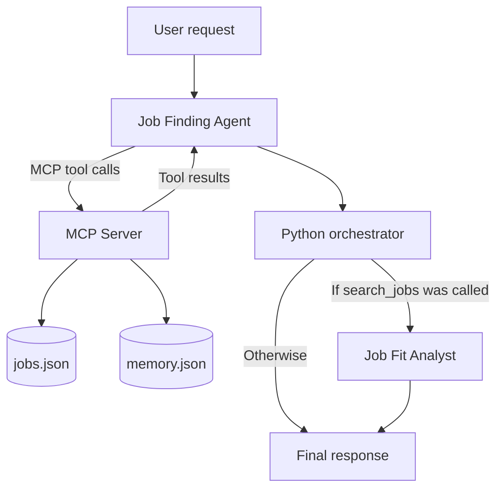

# TeamProject8_M3: Multi-Agent Job Finding System

**Course:** CEN 4930
**Milestone:** 3
**Team:** George Stephen and Manuel Rosales

## Problem

Job seekers waste time searching through listings that do not match their location, schedule, pay, or skills. This project uses a multi-agent system that interprets job-search requests, searches a local job database, and evaluates how well the returned listings match the user's criteria.

## System Architecture

The system uses two agents with separate responsibilities:

1. **Job Finding Agent:** Interprets the user's request, selects search filters, calls MCP tools, and reports the actual results.
2. **Job Fit Analyst:** Evaluates the search results against the original request and explains matches, limitations, and missing information.

A Python orchestrator runs the agents sequentially. After the Job Finding Agent calls `search_jobs`, the orchestrator passes the original request and the first agent's final text output to the Job Fit Analyst. The analyst runs only when a search tool call is detected.

The MCP server provides job-search tools and persistent preference storage.



## Features

- Natural-language job-search requests.
- Filtering by keywords, location, remote status, employment type, minimum salary, and skills.
- A second agent that evaluates returned listings against the user's criteria.
- Persistent preferences through `save_preference`, `get_saved_preferences`, and `clear_saved_preferences`.
- Honest no-match responses instead of fabricated listings.
- Clarifying questions for ambiguous requests.
- MCP server communication over standard input/output (stdio).

## Technology Stack

- Python
- OpenAI Agents SDK
- OpenAI-compatible course NRP inference endpoint using `gpt-oss`
- Model Context Protocol (MCP) and FastMCP
- JSON files for sample job data and saved preferences
- `pytest` and `unittest` for automated testing

## Setup and Run

Requires Python 3.10 or newer and access to the course NRP endpoint.

1. Clone the repository and open a terminal in the project folder.
2. Create and activate a virtual environment if desired.
3. Install dependencies:

   ```bash
   pip install -r requirements.txt
   ```

4. Create a `.env` file in the project root with the course-provided settings:

   ```text
   NRP_API_KEY=your_key_here
   NRP_BASE_URL=your_course_nrp_base_url
   ```

   Keep `.env` private. Never commit API keys or other credentials.

5. Start the system:

   ```bash
   python job_agent.py
   ```

6. Enter a job-search request at the `You:` prompt. Type `exit` to quit.

## Testing

Run the automated tests with:

```bash
python -m pytest -v
```

The current test suite contains 16 passing tests:

- 10 job-search tests covering filters, missing or malformed data, and no-match results.
- 6 memory tests covering saving, retrieving, validating, and clearing preferences.

Manual demonstrations have also verified matching searches, no-match searches, saved-preference persistence across restart, clarification for an ambiguous request, and a refusal to fabricate jobs. These demonstrations do not replace the remaining planned integration tests.

See `tests/test_cases.md` for the evaluation plan, expected results, verification status, and limitations.

## Known Limitations

1. **Sample data only:** `jobs.json` contains eight fictional listings. The system is not connected to live job boards.
2. **Rule-based matching:** Keyword and skill matching use simple text rules and do not provide comprehensive semantic matching.
3. **Model-dependent filter selection:** The agent interprets requests using a language model, so filter choices may vary.
4. **Text-based agent transfer:** The orchestrator passes the first agent's final text output to the analyst rather than a structured raw MCP result object.
5. **Local persistence:** Preferences are stored in `memory.json` on the machine running the project. This is not a multi-user database.
6. **Inference dependency:** Agent responses depend on the availability and behavior of the course NRP endpoint.
7. **No job applications:** The system does not contact employers, submit applications, or verify whether a listing is currently open.

## CHANGES

### Milestone 3

- Extended the M2 single-agent prototype into a two-agent workflow.
- Added the Job Fit Analyst to assess returned listings against user requirements.
- Added sequential orchestration that invokes the analyst after an actual `search_jobs` tool call.
- Added MCP tools for saving, retrieving, and clearing user-approved job preferences.
- Added persistent JSON-based preference storage and input validation.
- Added automated tests for job search and memory operations.
- Expanded the evaluation plan to cover handoff behavior, ambiguous requests, prompt injection, reliability, and combined filters.
- Documented architecture, evaluation evidence, and remaining limitations.
