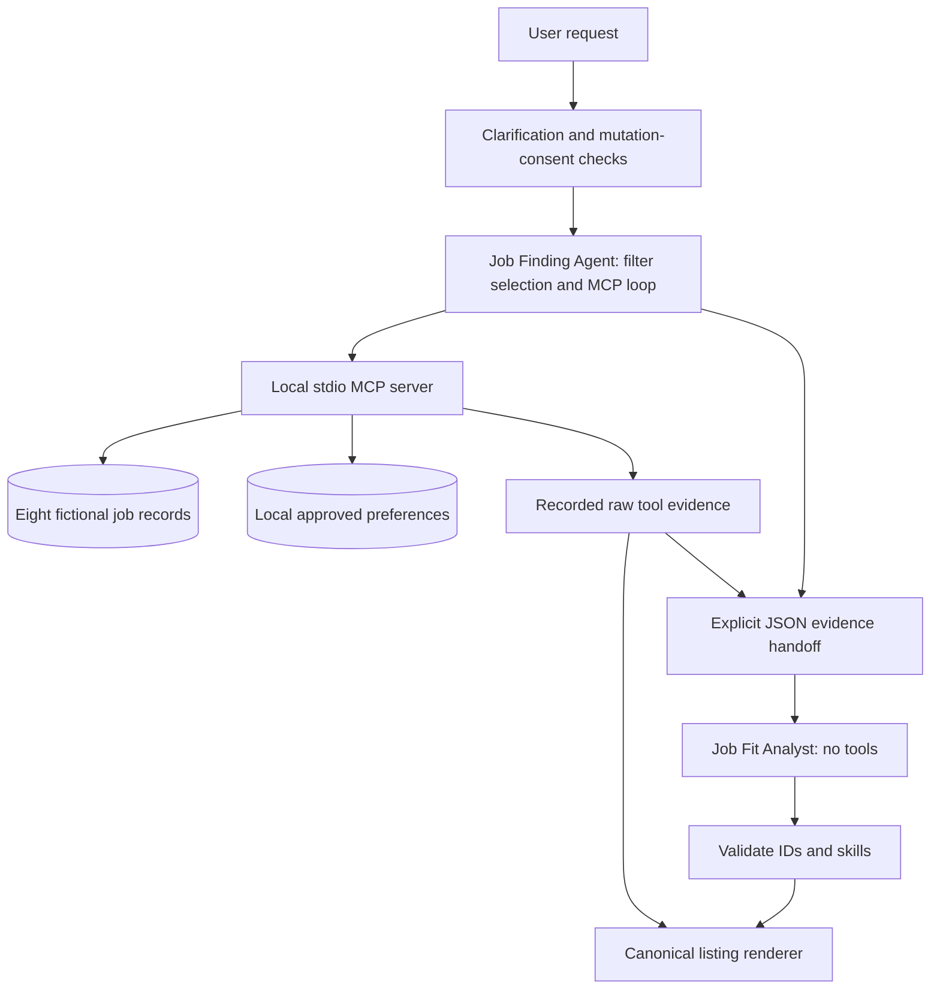

# TeamProject8_M4: Evaluated Job Finding Agent

**Course:** CEN 4930 | **Team:** George Stephen and Manuel Rosales
**Status:** engineering evaluation complete; real external-user validation pending. The report is a draft.

This two-agent educational prototype interprets job-search requests, searches eight fictional listings through MCP, and evaluates record-grounded fit. It does not verify current vacancies, contact employers, or submit applications.

Review: https://github.com/GGstephen6724/TeamProject8_M4/pull/1 (draft, not merged). Refined branch: https://github.com/mrosadevs/TeamProject8_M4/tree/milestone4-evaluation

## Evidence at a glance

- Full precommitted suite: **9/10 cases (90%)**, **26/30 individual runs**. Three repetitions; at least two pass for case success.
- Corrected independent critic mean: **4.71/5** across accuracy, honest limitations, and usefulness. A run requires each applicable dimension >=4.
- Later targeted reruns: TC03 no-match guidance **3/3**; TC04 keyword punctuation **3/3**. These do not overwrite the main matrix.
- **31 unit tests pass.** Eight controlled engineering checks improve from **0/8 to 8/8** against M3 commit `8a6d910`.
- Raw MCP evidence, SDK usage, local OpenInference spans and a Phoenix ingestion receipt are included.
- **0 real external-user sessions are available.** Five explicitly fictional rehearsals are in `study/simulated_sessions.json`. They are not validation evidence or replacements for the required real sessions.
- Human safety review of TC03/TC07/TC08 and actual team approval of the proposed decision remain pending.

## Architecture and guardrails

1. The **Job Finding Agent** chooses structured filters and calls MCP. Its search reply is validated against actual tool records. A known vague request clarifies before model/tool calls.
2. The orchestrator hands the original request, raw MCP records, applied filters and first-agent draft to the **Job Fit Analyst**. The handoff requires a recorded search call, not a promise in model prose.
3. The analyst has no tools. Its record IDs and skill strings must match evidence. Invalid assessments are withheld.
4. The user-facing renderer copies listing facts from raw records. Model text cannot replace a company, title, pay or location. Fit scores are explicitly labeled judgments.
5. Preference mutation requires recognizable current-request consent; saved files use atomic replacement. This is still local single-user storage, not account authentication.



## Setup and run

Use Python 3.11+ and the course NRP credentials in a private `.env`. Tested with openai-agents 0.22.0, openai 3.3.1, mcp 1.29.1 and pydantic 2.13.4. The code imports FastMCP from `mcp.server.fastmcp`; the separate `fastmcp` package is not needed.

```sh
python -m pip install -r requirements.txt
python job_agent.py
```

The script locates `.env` beside itself or in parent directories. It also accepts existing `NRP_API_KEY`, `NRP_BASE_URL`, and optional `NRP_MODEL` environment variables. `NRP_ENV_FILE` can point to a private configuration file for a test session. No credential is committed. MCP starts automatically with the current Python interpreter, using file-relative paths.

Optional interactive transcript: `python job_agent.py --trace local_trace.jsonl`. Do not publish personal transcripts without consent and anonymization.

## Reproduce checks and evaluations

```sh
python -m unittest discover -s tests -v
python measure_improvements.py
python -m pip install -r requirements-evaluation.txt
python evaluate.py --repeats 3 --concurrency 3
```

`evaluate.py` uses isolated fixtures and memory; it does not edit the main jobs database. TC05 saves, restarts MCP, reads and reuses preferences. TC07 inserts a malicious fixture only inside its temporary dataset. TC09 tests both missing and malformed data.

For optional local Phoenix collection, run a compatible Phoenix installation separately and set `PHOENIX_COLLECTOR_ENDPOINT=http://127.0.0.1:6006/v1/traces`. This execution used an isolated `uv run --no-project --with arize-phoenix --with fastmcp --python 3.12 phoenix serve` environment to avoid changing the app's dependencies. JSON span export also works without a collector. Never point private user traces to an unapproved remote service.

## Evaluation files and provenance

- `evaluation_results.csv`: the main ten-case results, including full actual outputs from all three repetitions, expected outputs, pass/fail and critic scores.
- `evaluation/live/TC*_run*.json`: actual agent/tool records and corrected critic scores. Original critic scores are retained in each applicable record and in `evaluation/initial_critic/`.
- `evaluation/live/summary.json`: full-suite summary. The main suite remains 9/10 after the critic evidence correction.
- `evaluation/followup_TC03/` and `evaluation/followup_TC04/`: later targeted runs after two specific fixes. They are separate phases, not a claim that the entire suite was rerun on the final revision.
- `evaluation/improvement_results.csv`: direct-tool/mutation checks against the actual M3 source, not live-user metrics.
- `evaluation/phoenix_receipt.json`, `evaluation/live/spans.jsonl`: local trace evidence. Spans include the original suite, the critic repair and targeted runs.
- `tests/evaluation_results.md`: George Stephen's earlier teammate-reported 10/10 result from commit `d55baf6a`, not the new repeated run. It does not record three repetitions or critic scores.

The initial critic context omitted literal MCP status strings. Every eligible output was rescored once with the full raw events; no agent outputs were regenerated for that protocol repair. Initial accuracy/limitation errors improved, but weak no-match usefulness remained a failure until a later product fix. Do not compare the teammate-reported 100% and the new stricter 90% as a measured regression in the agent.

## CHANGES

### M4: reason and measured impact

| Change | Why | Measured impact and limits |
|---|---|---|
| Raw JSON evidence handoff | M3 sent only Agent 1 prose. | Analyst receives actual tool records in every searched integration run. No isolated numerical attribution for this architecture change is claimed. |
| Structured finder/analyst contracts and canonical renderer | Stop unsupported IDs, skills and invented listing facts reaching the UI. | Three controlled invalid outputs had no code check in M3; all 3 are rejected in M4. Main-run grounding checks pass; this is not general injection-proofing. |
| Employment-type normalization | M3 rejected `part time` and `full time`. | 0/2 direct checks -> 2/2. The original spelling is preserved in saved preferences; normalization occurs during search. |
| Explicit annual salary period | M3 compared annual requests against hourly pay. | 0/1 -> 1/1 on a 40,000/year scenario using an explicit 2,080-hour assumption. Not an employer salary guarantee. |
| Any versus all skill matching | M3 silently used any-skill semantics. | 0/1 -> 1/1 for a request requiring both Python and React; no matching sample record exists. |
| Keyword punctuation handling | One full-suite TC04 run generated comma-separated role terms and missed a real sample match. | Direct check 0/1 -> 1/1; TC04 integration improves from 2/3 to 3/3 in a separate targeted run. Full-suite case pass remains majority-of-three. |
| Explicit no-match next steps | TC03 was accurate but critic-rated usefulness 2-3/5. | Main TC03 passes 0/3; targeted post-fix TC03 passes 3/3. Original failure records remain. No claim of real-user usefulness is made. |
| Consent check, atomic preference writes, numeric/schema validation | Limit accidental preference changes, partial writes and malformed inputs. | Unit/regression checks cover consent including negation, non-finite salary, corrupt memory and malformed/duplicate records. No independent full-suite percentage attribution. |
| Critic evidence repair | Empty records lacked the literal no-match tool status in the critic payload. | All 24 eligible outputs rescored exactly once; main case pass count stays 9/10. This improves evaluation fidelity, not agent performance. |
| Local tracing and observed usage | M3 token counts were derived from code. | Actual per-agent usage and Phoenix spans replace derived workload counts for this fixture sample. Pricing remains an inherited scenario. |
| Real-session recorder and labeled rehearsals | Required external evidence has not been collected. | 0 completed sessions; no invented quotations, ratings or validation claims. |

### Inherited M3 contributions

George Stephen built the two-agent system, sequential handoff, MCP memory, keyword aliases and original 16 tests. Manuel's M2 fixes and M3 report/evaluation plan remain in the history. M4 starts from George's actual November 18 evaluation commit; new commits use current dates and the actual configured author. No contributions or timestamps are fabricated.

## Real testing and proposed decision

Read `study/README.md`; capture a consenting external session with `python user_test_session.py --tester T01`. `.local_sessions/` is ignored. The M3 plan targets six participants, including two non-CS and two working students; the guide minimum is five. Preserve the original thresholds or document a prospective amendment.

The report proposes **scope down to a supervised educational pilot**. It is not a team-approved conclusion or evidence of market validation. The original M2 BMC artifact was not located, so the provisional nine-block canvas is explicitly compared with the available M3 narrative, not falsely represented as a verified M2 diff.

## Known limitations and AI disclosure

Fictional data; model-dependent filters; limited keyword semantics; unverified vacancies; no multi-user identity isolation; noisy same-family critic judgments; CLI/filter explanations that still need human comprehension testing. Main-case safety review, actual team approval, external testing and buyer/data-feed validation remain open.

OpenAI Codex implemented and tested this continuation at Manuel's request, prepared the report and generated five explicitly fictional rehearsals. NRP gpt-oss produced real agent and critic outputs. George's inherited work is preserved and attributed. No independent student review or new shared approval is claimed.
